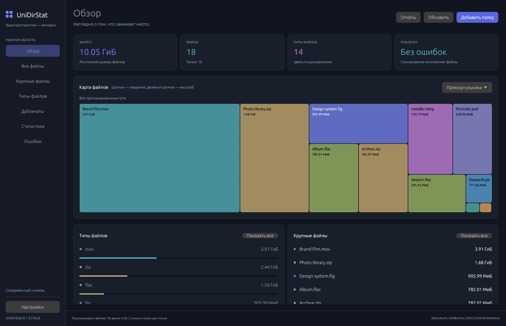

# UniDirStat

[English](#english) | [Русский](#russian)

## English

A modern disk usage explorer written in Rust for **Windows, macOS, and Linux**, inspired by [WinDirStat](https://github.com/windirstat/windirstat). UniDirStat is an independent implementation and does not claim full feature parity.

### Run

Requires **Rust 1.88 or newer**.

```sh
cargo run --release --locked
cargo run --release --locked -- ~/Downloads ~/Documents
cargo run --release --locked -- --settings ./unidirstat-settings.json ~/Downloads
```

The default build includes the native GUI. Multiple folders, mounted volumes, and network paths exposed by the OS can be scanned together. On macOS, a first-run access guide explains optional Full Disk Access before scanning. Only you can enable this in System Settings; limited scanning remains available. Protected paths and local ad-hoc build updates can still require OS permission prompts.

- **macOS:** install Xcode Command Line Tools. `sh scripts/package-macos.sh` creates `target/packages/UniDirStat-<version>-macos-<architecture>.dmg` containing the app and an Applications shortcut. The script prints the separately staged app path. Local ad-hoc signing is used; notarization has not been performed.
- **Windows:** use Rust MSVC, Visual Studio Build Tools and Inno Setup 6. Run `./scripts/package-windows.ps1` from PowerShell to create the x86_64 setup installer in `target/packages/`.
- **Linux:** on Debian/Ubuntu, install `pkg-config`, `libxkbcommon-dev`, `libwayland-dev`, and `libgl1-mesa-dev`. Native dialogs require `xdg-desktop-portal` and its desktop backend. `sh scripts/package-linux.sh` builds x86_64 AppImage and `.deb` packages; it also needs `desktop-file-utils`, `patchelf`, `dpkg-deb`, and the `LINUXDEPLOY` executable.

### Features

- **Parallel scans:** a bounded worker pool, multiple roots with overlapping paths counted once, progress, pause/resume, cancellation, partial results, full refresh, and selected-folder refresh. Set workers to `0` for automatic selection or `1..64` explicitly.
- **File browser and search:** a virtualized directory tree and largest-file list; sorting by name, size, or modified time; asynchronous indexed parallel text/regex searches by name or path. Filters cover minimum/maximum size and modified age, kind, extension, owner UID where available, and folders empty in the scan. Save and reuse named filter profiles.
- **Linked workspace:** an expandable size-descending file tree above the map, resizable panes and columns, parent-relative size bars, shared multi-selection and folder-region highlights. Clicking a map item reveals it in the tree. The side panel shows file types and largest files for the focused folder.
- **Storage maps:** hierarchical treemap, readable flame graph, and sunburst with clipped/ellipsized labels, tiny-content aggregates, pointer-anchored wheel zoom, drag panning and animated double-click focus. Zoom out and Reset remain explicit controls.
- **Appearance and language:** persistent System/Light/Dark themes and System/English/Russian choices, visible above Settings in the left sidebar. System checks preferred locales in order for supported English/Russian variants, otherwise English. Missing translations fall back to English. Short navigation transitions can be reduced in Settings. Interface scale and Modified/Share columns are configurable.
- **Responsive interaction:** map generation runs in a cancellable background job with a small cache; returning from Overview to the same file view preserves its rows. File rows, overview previews and maps have context menus. Cmd/Ctrl toggles selection, Shift selects row ranges, and Cmd/Ctrl+A selects the current file list; selected paths can be copied together. Cleanup remains per-item with confirmation.
- **Visible progress:** scanning shows the last directory, logical/allocated bytes and elapsed time; finalization, indexing, sorting, filtering and result assembly show actual stage counters. Map counters show discovered work rather than a guessed overall percentage. A stalled scan suggests checking filesystem operations or a permission dialog.
- **Logical and allocated size:** Unix blocks and Windows allocation metadata where available. Logical bytes count each path; allocated bytes count identified hard links once. Unavailable metadata is marked.
- **Exact duplicates:** bounded parallel SHA-256 or SHA-512 after grouping by size. Larger same-sized candidates first compare small sampled regions to reject obvious differences; a match still requires a full-file hash. Empty files and identified hard links are not counted as reclaimable duplicate copies. Changed, replaced, or inaccessible files are rejected with errors.
- **Snapshots and reports:** validated JSON and UniDirStat scan CSV import/export, plus JSON/CSV duplicate and permission-metadata reports. CSV import accepts legacy 11-column and current 13-column scan files; the current format preserves file identity and scan metadata. Reports use temporary files and atomic replacement.
- **Permissions and insights:** read-only status, Unix mode/owner UID, file-age buckets, and configurable estimated monthly storage cost. Inspect native ACL output using `/bin/ls -lde` on macOS, optional `getfacl` on Linux, or `icacls` on Windows; ACL editing is not implemented.
- **Filesystem monitoring:** native change notifications trigger a full rescan after a two-second debounce. Watcher failures are shown; OS limits apply to large or network filesystems.
- **File actions:** open, reveal, copy path, confirmed system-trash cleanup, and atomic file/folder moves within one filesystem without overwriting existing destinations. Empty-folder cleanup checks again that the live folder is empty before trashing it.
- **Portable preferences:** use `--settings FILE` for GUI preferences in an explicit JSON file instead of the OS application-settings location. Missing files start with defaults; invalid files are reported and preserved. The import limit is 1 MiB.

Scanning reads metadata, not file contents. Duplicate detection reads contents only when requested. Symbolic links and Windows reparse points are never traversed.

Directory identities are visited once, including macOS firmlink aliases. The macOS boot System/Data volumes appear as one card when their shared directory namespace is verified; other volumes remain separate.

Scan progress distinguishes logical bytes from allocated blocks. Logical size can exceed disk capacity because of sparse files and hard links. Allocation is not exclusive physical usage: APFS clones can share blocks, while snapshots and filesystem metadata are not included. Unknown allocation is shown as unavailable, not replaced by logical size. After updating from an earlier version, run a new scan to replace old totals.

### Using the GUI

1. Choose **Add folder** or a volume on the welcome screen. Adding folders extends the scan roots.
2. Select a file in a table or map to open its details and available actions.
3. Use the wheel over a map to zoom at the pointer, drag to pan, or double-click a folder for animated focus. **Zoom to selection** focuses the selected folder; **Zoom out / Reset** returns. Side statistics follow the focused folder; visual panning alone does not change that scope. Tree filters do not hide unrelated map regions.
4. Use **All files → Advanced filters** for search and saved profiles. **Duplicates** selects the hash algorithm and exports results; **Reports** opens/saves snapshots and exports scan or permission metadata.
5. Use the selected folder's **Refresh this folder**, **Inspect system ACL**, or confirmed cleanup actions when available. Empty-folder candidates require a completed scan. Exclusions and filesystem boundaries can hide contents; cleanup always rechecks live emptiness.
6. In **Settings**, choose language, theme, interface scale, columns, map styling, worker count, exclusions, allocation mode, and monitoring.

| Shortcut | Action |
| --- | --- |
| `F5` | Refresh all scan roots |
| `F6` | Pause/resume the active scan or duplicate job, including preparation |
| `Esc` | Cancel the active cancellable scan or duplicate job |

Pause/cancel requests are checked during traversal and result preparation. A current operating-system filesystem call may need to return before a request takes effect.

Imported snapshots are read-only and never authorize file changes. **Refresh** performs a new live scan on this computer before cleanup becomes available. Scan roots cannot be moved or trashed; scan their parent to manage them.

### Headless CLI

The CLI remains usable without GUI dependencies:

```sh
cargo build --release --no-default-features --locked
./target/release/unidirstat --help
./target/release/unidirstat --scan /data --threads 8 --export scan.json
./target/release/unidirstat --load scan.json --export scan.csv
./target/release/unidirstat --load scan.csv --search '\.rs$' --regex --name-only --max-size 1048576 --kind file --sort name --ascending
./target/release/unidirstat --scan /data --duplicates duplicates.csv --hash sha512 --threads 8
./target/release/unidirstat --load scan.json --permissions permissions.csv
./target/release/unidirstat --scan /data --empty-directories
```

These shell examples use macOS/Linux paths; on Windows, use the corresponding paths and `.\target\release\unidirstat.exe`.

- Input/output: repeat `--scan FOLDER`, use positional folders, or `--load FILE` for JSON/CSV. `--export FILE`, `--duplicates FILE`, and `--permissions FILE` select JSON/CSV by extension and imply headless mode.
- Performance/exclusions: `--threads 0..64`, repeatable `--exclude REGEX`, and `--one-file-system` on Unix.
- Text search: `--search TEXT`, `--regex`, and `--name-only`. Search/filter flags imply headless mode.
- Ranges: `--min-size` / `--max-size` use bytes; `--min-age` / `--max-age` use modified-age days. GUI size filters use MiB.
- Other filters: repeatable `--kind file|directory|symlink|other`, `--extension EXT`, `--owner UID`, and `--empty-directories`.
- Search order/size: `--sort size|name|modified`, `--ascending`, and `--allocated`.
- Duplicate algorithm: `--hash sha256|sha512`, default `sha256`.
- Desktop preferences: `--settings FILE` selects portable GUI settings; headless operations use their explicit CLI arguments.
- General: `--no-gui`, `--help`, and `--` to treat remaining arguments as paths.

CLI summaries report scan errors; reports preserve available results and error information. A partial scan is not a complete inventory.

### Limits

Not implemented: raw NTFS/MFT acceleration, MTP access, deleted-file recovery, NTFS compression/deduplication and OS cleanup integrations, ACL editing, custom cleanup commands/plugins, permanent deletion, emptying the system trash, shell/Explorer integration, and Hilbert/Moore layouts. There is no mobile/browser build with arbitrary disk access.

A scan observes a changing filesystem; it is not an atomic filesystem snapshot. File actions require confirmation and current metadata validation. Cross-filesystem moves fail without deleting the source. Windows identity uses a 64-bit file index; 128-bit ReFS identity is not supported. On Unix, paths containing invalid UTF-8 cannot be exported to JSON/CSV.

JSON/CSV snapshot imports are limited to 256 MiB. All scan nodes and the search index remain in memory. Subpixel map contents are represented by aggregate regions; flame depth adapts to readable bands (up to 64 levels) and the GUI sunburst shows up to 12. Zoom into a deeper folder to continue. Storage cost is an estimate, not a provider bill. Technical OS errors and native ACL output may retain their source language.

### Checks and project notes

```sh
cargo fmt --all -- --check
cargo test --all-features --locked
cargo clippy --all-targets --all-features --locked -- -D warnings
cargo build --release --locked
cargo test --no-default-features --locked
```

[CI](.github/workflows/ci.yml) defines checks and packaging for macOS arm64/x86_64, Windows x86_64, and Linux x86_64. Pushing a `v<package-version>` tag builds all five installer assets and publishes a GitHub Release only after every job and asset verification succeeds. No release is currently published. The in-app update check is intentionally disabled until publication; it makes no network requests. macOS packages are ad-hoc signed, Windows packages are unsigned. Native GUI checks are performed on the macOS host; Windows/Linux execution and hosted Actions are not yet verified. Translation contributions: [localization guide](docs/localization.md).

License: **GPL-3.0-or-later**.

### Support development

If UniDirStat is useful to you, you can [support development with a voluntary contribution of any amount](https://app.lava.top/4026101527). Support is not a condition of using the software and does not include any promise of paid services.

<a id="russian"></a>

## Русский

Современный анализатор дискового пространства на Rust для **Windows, macOS и Linux**, вдохновлённый [WinDirStat](https://github.com/windirstat/windirstat). UniDirStat — самостоятельная реализация, без заявления о полном совпадении функций.



[Снимок светлой темы](docs/screenshots/light.png). Эти снимки работающего приложения на macOS сделаны на тестовом каталоге со sparse-файлами, а не на пользовательском диске.

### Запуск

Нужен **Rust 1.88 или новее**.

```sh
cargo run --release --locked
cargo run --release --locked -- ~/Downloads ~/Documents
cargo run --release --locked -- --settings ./unidirstat-settings.json ~/Downloads
```

Обычная сборка включает графический интерфейс. Можно одновременно сканировать несколько папок, смонтированных дисков и сетевых путей, доступных через ОС. При первом запуске на macOS мастер объясняет необязательный полный доступ к диску до сканирования. Его включает только пользователь в системных настройках; ограниченное сканирование тоже доступно. Защищённые пути и обновления локальной ad-hoc сборки могут по-прежнему вызывать запросы ОС.

- **macOS:** установите Xcode Command Line Tools. `sh scripts/package-macos.sh` создаёт `target/packages/UniDirStat-<версия>-macos-<архитектура>.dmg` с приложением и ссылкой на Applications. Путь к отдельно подготовленному `.app` выводится в конце. Подпись локальная ad hoc; notarization не выполнялась.
- **Windows:** нужны Rust MSVC, Visual Studio Build Tools и Inno Setup 6. Команда PowerShell `./scripts/package-windows.ps1` создаёт установщик x86_64 в `target/packages/`.
- **Linux:** на Debian/Ubuntu нужны `pkg-config`, `libxkbcommon-dev`, `libwayland-dev`, `libgl1-mesa-dev`, а для диалогов — `xdg-desktop-portal` с backend рабочего стола. `sh scripts/package-linux.sh` собирает AppImage и `.deb` для x86_64; дополнительно нужны `desktop-file-utils`, `patchelf`, `dpkg-deb` и исполняемый файл `LINUXDEPLOY`.

### Возможности

- **Параллельное сканирование:** ограниченный пул потоков, несколько корней без повторного учёта пересекающихся путей, прогресс, пауза/продолжение, отмена, частичные результаты, полное обновление и обновление выбранной папки. Число потоков: `0` — автоматически, `1..64` — вручную.
- **Дерево и поиск:** виртуализированные списки папок и крупнейших файлов; сортировка по имени, размеру и времени изменения; асинхронный индексированный параллельный поиск текста/regex по имени или пути. Фильтры охватывают минимальный/максимальный размер и возраст изменения, тип, расширение, доступный UID владельца и папки, пустые по данным скана. Именованные профили фильтров можно сохранять и применять повторно.
- **Связанная рабочая область:** дерево файлов над картой, тяжёлые объекты сверху, регулируемые панели и столбцы, полосы доли от родителя, общее мультивыделение и подсветка области папки. Щелчок по карте раскрывает путь в дереве. Боковая панель показывает типы и крупнейшие файлы открытой папки.
- **Карты файлов:** иерархические прямоугольники, читаемый flame graph и sunburst с обрезанными подписями, группами мелких файлов, масштабированием колесом к указателю, перетаскиванием и плавным приближением двойным щелчком. Кнопки возврата и сброса остаются доступны.
- **Внешний вид и язык:** сохраняемые темы «Системная / Светлая / Тёмная» и язык «Системный / English / Русский» доступны в левом сайдбаре над настройками. Системный режим перебирает предпочитаемые локали до первого поддерживаемого варианта русского/английского, иначе выбирает английский. Отсутствующий перевод заменяется английским. Короткие анимации навигации можно уменьшить в настройках. Настраиваются масштаб интерфейса и столбцы «Изменён»/«Доля».
- **Отзывчивое управление:** карта строится в отменяемом фоновом задании с небольшим кэшем; возврат из обзора к прежнему списку файлов сохраняет строки. Строки файлов, списки обзора и карты имеют контекстные меню. Cmd/Ctrl добавляет или снимает выделение, Shift выделяет диапазон строк, Cmd/Ctrl+A — текущий список файлов; выбранные пути можно скопировать вместе. Очистка остаётся по одному объекту с подтверждением.
- **Понятный прогресс:** скан показывает последний каталог, логический/занятый размер и время; подведение итогов, индексирование, сортировка, фильтрация и сборка результатов показывают реальные счётчики этапа. Счётчики карты отражают обнаруженную работу, а не выдуманный общий процент. При остановке прогресса появляется подсказка проверить файловую систему или окно разрешений.
- **Логический и занятый размер:** используются blocks Unix и доступные данные allocation Windows. Логический размер учитывается по каждому пути; занятое место жёстких ссылок — один раз на идентификатор. Недоступные значения помечаются.
- **Точные дубликаты:** ограниченный параллельный пул SHA-256 или SHA-512 после группировки по размеру. У крупных кандидатов сначала сравниваются небольшие фрагменты для отсева различий; совпадение обязательно подтверждается полным хешем. Пустые файлы и распознанные жёсткие ссылки не считаются освобождаемыми копиями. Изменённые, заменённые и недоступные файлы исключаются с сообщением об ошибке.
- **Снимки и отчёты:** импорт/экспорт JSON и CSV-снимков UniDirStat с проверкой структуры, отчёты о дубликатах и метаданных прав доступа в JSON/CSV. Импорт CSV читает старые 11-столбцовые и нынешние 13-столбцовые снимки; новый формат сохраняет идентификаторы файлов и метаданные сканирования. Запись выполняется через временный файл с атомарной заменой.
- **Права и статистика:** признак «только чтение», Unix mode/UID, возрастные группы файлов и настраиваемая оценка месячной стоимости хранения. Системные ACL просматриваются через `/bin/ls -lde` на macOS, необязательный `getfacl` на Linux или `icacls` на Windows; изменение ACL не реализовано.
- **Мониторинг файловой системы:** системные уведомления запускают полный повторный обход с задержкой две секунды. Ошибки наблюдения отображаются; для больших и сетевых файловых систем действуют ограничения ОС.
- **Действия с файлами:** открыть, показать в файловом менеджере, скопировать путь, отправить в системную корзину с подтверждением и атомарно переместить файл/папку внутри одной файловой системы без перезаписи. Перед очисткой пустой папки заново проверяется, что она всё ещё пуста.
- **Переносимые настройки:** `--settings FILE` задаёт отдельный JSON-файл настроек GUI вместо системного хранилища приложения. Отсутствующий файл создаётся из настроек по умолчанию; некорректный файл сохраняется без перезаписи, ошибка показывается. Ограничение импорта — 1 МиБ.

Сканирование читает метаданные, а не содержимое файлов. Содержимое читается только по запросу поиска дубликатов. Символические ссылки и Windows reparse points не обходятся.

Каждый идентификатор каталога обходится один раз, включая альтернативные firmlink-пути macOS. Загрузочные тома macOS «Система»/«Данные» показаны одной карточкой, если подтверждено общее пространство каталогов; остальные тома остаются раздельными.

Прогресс различает логический размер и занятые блоки. Логический размер может превышать ёмкость диска из-за sparse-файлов и жёстких ссылок. Занятые блоки — не эксклюзивный физический объём: клоны APFS могут использовать общие блоки, а снимки и служебные данные файловой системы не учитываются. Неизвестный занятый размер отмечается как недоступный, без подмены логическим. После обновления старой версии запустите новый скан, чтобы заменить прежние итоги.

### Работа с интерфейсом

1. Нажмите **Добавить папку** или выберите диск на стартовом экране. Добавление папок расширяет список корней.
2. Выберите файл в таблице или на карте: справа откроются сведения и доступные действия.
3. Колесо над картой приближает к указателю, перетаскивание перемещает карту, двойной щелчок по папке плавно открывает её. **Приблизить выделенное** фокусирует выбранную папку; **На уровень выше / Сбросить** возвращают. Статистика относится к открытой папке; простое перемещение карты область статистики не меняет. Фильтры дерева не скрывают остальные области карты.
4. В разделе **Все файлы → Расширенные фильтры** доступны поиск и сохранённые профили. Раздел **Дубликаты** позволяет выбрать алгоритм хеширования и выгрузить результаты; **Отчёты** открывает/сохраняет снимки и экспортирует данные сканирования или прав доступа.
5. Для выбранной папки используйте **Обновить эту папку**, **Показать системные ACL** или доступные действия очистки с подтверждением. Поиск кандидатов в пустые папки требует завершённого сканирования. Исключения и границы файловых систем могут скрывать содержимое; перед очисткой всегда проверяется реальная пустота папки.
6. В **Настройках** задайте язык, тему, масштаб, столбцы, оформление карты, потоки, исключения, учёт занятого места и мониторинг.

| Клавиша | Действие |
| --- | --- |
| `F5` | Обновить все корни сканирования |
| `F6` | Пауза/продолжение активного сканирования или поиска дубликатов, включая подготовку результатов |
| `Esc` | Отменить активное сканирование или поиск дубликатов с поддержкой отмены |

Запросы паузы/отмены проверяются при обходе и подготовке результатов. Текущий системный вызов работы с файлами может сначала потребовать завершения.

Импортированные снимки доступны только для чтения и не разрешают изменение файлов. **Обновить** запускает новое живое сканирование на этом компьютере; после него становится доступна очистка. Корни сканирования защищены от перемещения и корзины: для управления ими сканируйте родительскую папку.

### CLI без графики

CLI работает без графических зависимостей:

```sh
cargo build --release --no-default-features --locked
./target/release/unidirstat --help
./target/release/unidirstat --scan /data --threads 8 --export scan.json
./target/release/unidirstat --load scan.json --export scan.csv
./target/release/unidirstat --load scan.csv --search '\.rs$' --regex --name-only --max-size 1048576 --kind file --sort name --ascending
./target/release/unidirstat --scan /data --duplicates duplicates.csv --hash sha512 --threads 8
./target/release/unidirstat --load scan.json --permissions permissions.csv
./target/release/unidirstat --scan /data --empty-directories
```

Примеры используют пути и оболочку macOS/Linux; в Windows укажите соответствующие пути и `.\target\release\unidirstat.exe`.

- Ввод/вывод: повторяемый `--scan FOLDER`, папки без ключа или `--load FILE` для JSON/CSV. `--export FILE`, `--duplicates FILE` и `--permissions FILE` выбирают JSON/CSV по расширению и включают режим без GUI.
- Потоки/исключения: `--threads 0..64`, повторяемый `--exclude REGEX` и `--one-file-system` на Unix.
- Текстовый поиск: `--search TEXT`, `--regex` и `--name-only`. Ключи поиска и фильтрации включают режим без GUI.
- Диапазоны: `--min-size` / `--max-size` задаются в байтах; `--min-age` / `--max-age` — в днях с момента изменения. Фильтры размера в GUI используют МиБ.
- Другие фильтры: повторяемый `--kind file|directory|symlink|other`, `--extension EXT`, `--owner UID` и `--empty-directories`.
- Порядок и размер в поиске: `--sort size|name|modified`, `--ascending` и `--allocated`.
- Хеш дубликатов: `--hash sha256|sha512`, по умолчанию `sha256`.
- Настройки интерфейса: `--settings FILE` выбирает переносимый файл GUI; операции без графики используют явно переданные параметры CLI.
- Общие ключи: `--no-gui`, `--help` и `--`, после которого оставшиеся аргументы считаются путями.

Сводка CLI сообщает число ошибок; отчёты сохраняют доступные результаты и сведения об ошибках. Неполный обход нельзя считать полной инвентаризацией.

### Ограничения

Не реализованы: прямое ускоренное сканирование NTFS/MFT, доступ MTP, восстановление удалённых файлов, сжатие/дедупликация NTFS и системные средства очистки, изменение ACL, произвольные cleanup-команды/плагины, безвозвратное удаление, очистка системной корзины, интеграция с оболочкой/Explorer и алгоритмы Hilbert/Moore. Мобильной или браузерной сборки с произвольным доступом к диску нет.

Скан наблюдает за меняющейся файловой системой, а не создаёт её атомарный снимок. Действия с файлами требуют подтверждения и проверки актуальных метаданных. Перенос между файловыми системами завершается ошибкой без удаления исходника. В Windows используется 64-битный индекс файла; 128-битные идентификаторы ReFS не поддерживаются. На Unix пути с некорректным UTF-8 нельзя экспортировать в JSON/CSV.

Импорт снимков JSON/CSV ограничен 256 МиБ. Все узлы сканирования и поисковый индекс хранятся в памяти. Содержимое меньше пикселя обозначается сгруппированными областями; глубина flame подбирается под читаемую высоту полос (до 64 уровней), sunburst в GUI показывает до 12. Более глубокие папки доступны увеличением. Стоимость хранения — оценка, а не счёт провайдера. Технические ошибки ОС и вывод системных ACL могут оставаться на исходном языке.

### Проверки и сведения о проекте

```sh
cargo fmt --all -- --check
cargo test --all-features --locked
cargo clippy --all-targets --all-features --locked -- -D warnings
cargo build --release --locked
cargo test --no-default-features --locked
```

В [CI](.github/workflows/ci.yml) настроены проверки и упаковка macOS arm64/x86_64, Windows x86_64 и Linux x86_64. Тег `v<версия-пакета>` запускает сборку всех пяти установочных файлов; GitHub Release публикуется только после успешных заданий и проверки файлов. Релизы пока не опубликованы. Проверка обновлений в программе намеренно отключена до публикации и не обращается к сети. Подпись macOS локальная ad hoc, установщик Windows не подписан. Живой GUI проверяется на текущем macOS-хосте; запуск Windows/Linux и облачный GitHub Actions ещё не проверены. Переводы: [руководство по локализации](docs/localization.md).

Лицензия: **GPL-3.0-or-later**.

### Поддержать разработку

Если UniDirStat оказался полезен, можно [добровольно поддержать разработку любой суммой](https://app.lava.top/4026101527). Поддержка не является условием использования программы и не подразумевает обещания платных услуг.
