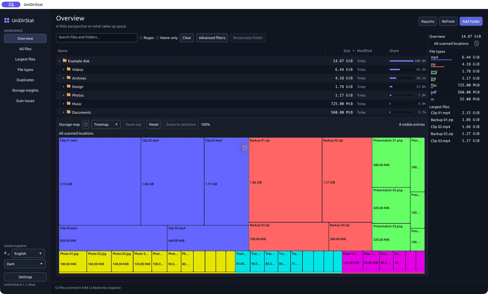

[English](README.md) | [Русский](README.ru.md)

# UniDirStat

A modern disk usage explorer written in Rust for **Windows, macOS, and Linux**, inspired by [WinDirStat](https://github.com/windirstat/windirstat). UniDirStat is an independent implementation and does not claim full feature parity.

Explore space usage with a linked file tree and interactive maps, find large files and exact duplicates, and refresh individual folders. Parallel scanning, English/Russian interfaces, and system, light, and dark themes are supported. Scans never follow symbolic links; cleanup uses the system trash with confirmation.

[Light theme](docs/screenshots/en-light.jpg). Screenshots show the macOS app with a read-only demo snapshot, not a user's disk inventory.

## Installation

**[Download latest release](https://github.com/Vitalick/UniDirStat/releases)**

Ready-to-install releases are not published yet. Until the first release, [build from source](docs/guide.md#build-and-run). Planned release formats:

| Platform | Architecture | Release asset |
| --- | --- | --- |
| macOS | Apple Silicon | `UniDirStat-<version>-macos-arm64.dmg` |
| macOS | Intel | `UniDirStat-<version>-macos-x86_64.dmg` |
| Windows | x64 | `UniDirStat-<version>-windows-x86_64-setup.exe` |
| Linux | x64 | `UniDirStat-<version>-linux-x86_64.AppImage` |
| Debian / Ubuntu | x64 | `UniDirStat-<version>-linux-x86_64.deb` |

Open the macOS DMG and drag UniDirStat into Applications; on Windows, run the installer. On Linux, make the AppImage executable (`chmod +x UniDirStat-*.AppImage`) and run it, or install the Debian package with `sudo apt install ./UniDirStat-*.deb`. Native Linux file dialogs require `xdg-desktop-portal` and a backend for your desktop.

macOS builds use local ad-hoc signing and are not notarized; Windows installers are unsigned. The OS may show an unverified-publisher warning. Do not disable system security protections. The in-app update check is currently a placeholder and makes no network requests.

## Documentation

[Full guide](docs/guide.md): features, GUI and shortcuts, CLI, size accounting, safety and limitations, building from source, checks, and releases. [Translation guide](docs/localization.md).

## Support development

If UniDirStat is useful to you, you can [support development with a voluntary contribution of any amount](https://app.lava.top/4026101527). Support is not a condition of using the software and does not include any promise of paid services.

## Stars

<a href="https://www.star-history.com/?type=date&repos=Vitalick%2FUniDirStat">
 <picture>
   <source media="(prefers-color-scheme: dark)" srcset="https://api.star-history.com/chart?repos=Vitalick/UniDirStat&type=date&theme=dark&legend=top-left" />
   <source media="(prefers-color-scheme: light)" srcset="https://api.star-history.com/chart?repos=Vitalick/UniDirStat&type=date&legend=top-left" />
   
 </picture>
</a>

**License:** [GPL-3.0-or-later](LICENSE). [Attribution and font license](docs/guide.md#license).
