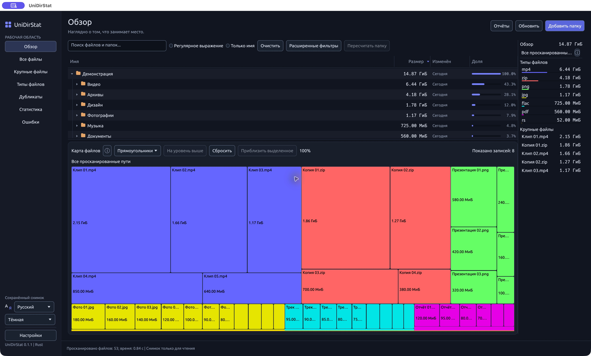

[English](README.md) | [Русский](README.ru.md)

# UniDirStat

Современный анализатор дискового пространства на Rust для **Windows, macOS и Linux**, вдохновлённый [WinDirStat](https://github.com/windirstat/windirstat). UniDirStat - самостоятельная реализация, без заявления о полном совпадении функций.

Изучайте занятое место через связанное дерево файлов и интерактивные карты, находите крупные файлы и точные дубликаты, пересчитывайте отдельные папки. Есть параллельное сканирование, русский и английский интерфейсы, системная, светлая и тёмная темы. Сканирование не следует по символическим ссылкам; очистка использует системную корзину с подтверждением.

[Светлая тема](docs/screenshots/ru-light.jpg). На снимках - приложение на macOS с демонстрационным снимком только для чтения, а не с данными пользовательского диска.

## Установка

**[Скачать последнюю версию](https://github.com/Vitalick/UniDirStat/releases)**

Готовые релизы пока не опубликованы. До первого выпуска [соберите приложение из исходников](docs/guide.ru.md#сборка-и-запуск). Форматы будущих релизов:

| Платформа | Архитектура | Файл релиза |
| --- | --- | --- |
| macOS | Apple Silicon | `UniDirStat-<version>-macos-arm64.dmg` |
| macOS | Intel | `UniDirStat-<version>-macos-x86_64.dmg` |
| Windows | x64 | `UniDirStat-<version>-windows-x86_64-setup.exe` |
| Linux | x64 | `UniDirStat-<version>-linux-x86_64.AppImage` |
| Debian / Ubuntu | x64 | `UniDirStat-<version>-linux-x86_64.deb` |

На macOS откройте DMG и перетащите UniDirStat в Applications; на Windows запустите установщик. На Linux сделайте AppImage исполняемым (`chmod +x UniDirStat-*.AppImage`) и запустите его либо установите Debian-пакет командой `sudo apt install ./UniDirStat-*.deb`. Для системных диалогов Linux нужны `xdg-desktop-portal` и backend вашего рабочего стола.

Сборки macOS подписаны локально ad hoc, без нотариализации; установщики Windows не подписаны. ОС может предупредить о непроверенном издателе. Не отключайте системные средства защиты. Проверка обновлений в программе пока является заглушкой и не обращается к сети.

## Документация

[Полное руководство](docs/guide.ru.md): возможности, интерфейс и сочетания клавиш, CLI, учёт размера, безопасность и ограничения, сборка из исходников, проверки и релизы. [Руководство по локализации](docs/localization.md) - на английском.

## Поддержать разработку

Если UniDirStat оказался полезен, можно [добровольно поддержать разработку любой суммой](https://app.lava.top/4026101527). Поддержка не является условием использования программы и не подразумевает обещания платных услуг.

## Звёзды

<a href="https://www.star-history.com/?type=date&repos=Vitalick%2FUniDirStat">
 <picture>
   <source media="(prefers-color-scheme: dark)" srcset="https://api.star-history.com/chart?repos=Vitalick/UniDirStat&type=date&theme=dark&legend=top-left" />
   <source media="(prefers-color-scheme: light)" srcset="https://api.star-history.com/chart?repos=Vitalick/UniDirStat&type=date&legend=top-left" />
   
 </picture>
</a>

**Лицензия:** [GPL-3.0-or-later](LICENSE). [Атрибуция и лицензия шрифта](docs/guide.ru.md#лицензия).
